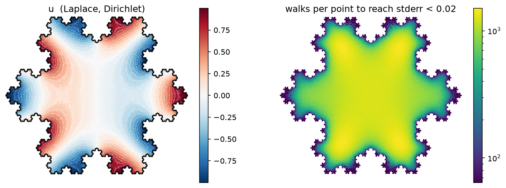
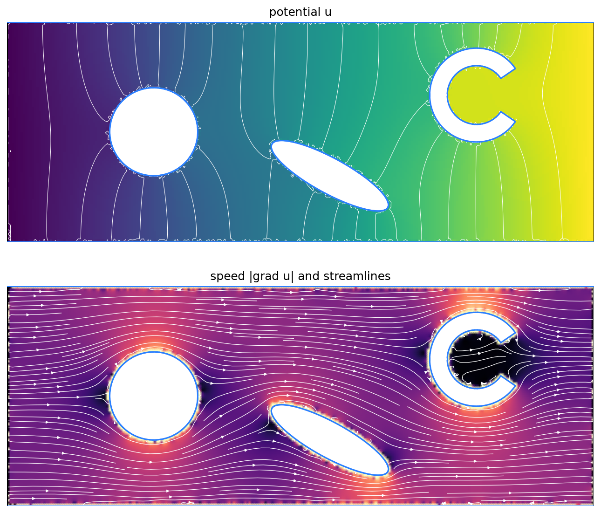
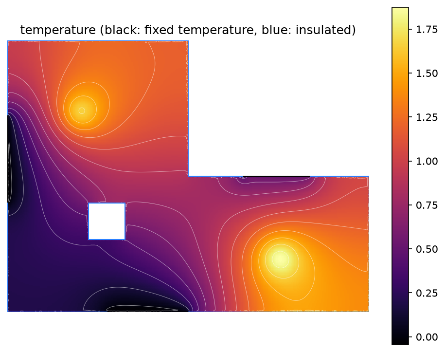
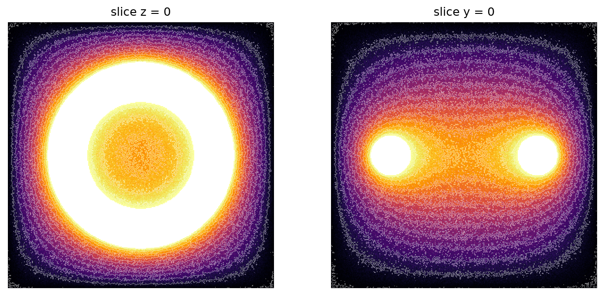

# Walk on Spheres / Walk on Stars

A grid-free Monte Carlo PDE solver in Python + Numba, built from scratch,
following the line of work by Keenan Crane's group at CMU (Sawhney & Crane
2020; Sawhney, Miller, Gkioulekas & Crane 2023).

It solves

```
Δu = -f      in a domain Ω
u  =  g      on Dirichlet boundaries
∂u/∂n = 0    on Neumann (insulating) boundaries
```

without ever building a mesh. All it needs is closest-point queries,
ray casts and (for Neumann) silhouette queries against the boundary, so
you can query `u` at any point independently, and a fractal boundary with
thousands of wiggles costs about as much as a square.



## How it works (one paragraph)

The value of a harmonic function at `x` equals its average over any circle
around `x` that fits in the domain. **Walk on Spheres** turns this into a
random walk: jump to a uniformly random point on the largest empty circle,
repeat until you're within ε of the boundary, and read off `g` there. The
average over many walks converges to `u(x)`. A source term `f` adds a
Green's function-weighted sample inside each circle. **Walk on Stars**
handles Neumann boundaries: circles may cross insulating walls, as long as
they contain no *silhouette* point, so the region stays star-shaped. A
random ray that hits a wall just stops there and the walk continues from
the wall.

## Quick start

```bash
cd ~/walk-on-spheres
```

```bash
python3 -m venv .venv && .venv/bin/pip install -r requirements.txt
```

```bash
.venv/bin/python -m pytest -q
```

```bash
PYTHONPATH=. .venv/bin/python demos/heat.py
```

```python
import numpy as np, wos
from wos import NEUMANN

scene = wos.Scene().add_loop(wos.rectangle(-2, -2, 2, 2, 100), values=lambda x, y: x)
scene.add_loop(wos.circle((0, 0), 0.5, 512), kinds=NEUMANN, hole=True)  # insulated hole

r = wos.solve(scene, np.array([[1.0, 0.3]]), n_walks=4096)
print(r.value, "+/-", r.stderr)

u, grad = wos.gradient(scene, np.array([[1.0, 0.3]]), n_walks=4096)

# Many query points (e.g. a whole image)? Cache once, then evaluate anywhere.
cache = wos.BoundaryCache(scene, n_points=4000, n_walks=1024, delta=0.01)
X, Y, P, mask = scene.grid(400)
res = cache.evaluate(P[mask], gradient=True)   # res.value, res.stderr, res.grad
```

## Layout

| path | what |
|---|---|
| `wos/geometry.py` | `Scene` (loops of Dirichlet/Neumann segments), BVH, normal cones, shapes |
| `wos/baseline.py` | textbook WoS in plain NumPy: the reference / starting point |
| `wos/_kernels.py` | Numba kernels: RNG, BVH queries, WoS/WoSt walk, gradients, 3D |
| `wos/solver.py` | public API: `solve`, `gradient`, `solve_grid`, `solve_sdf3` |
| `wos/cache.py` | `BoundaryCache`: boundary value caching (walks only on the boundary) |
| `tests/` | 24 tests against closed-form solutions |
| `demos/` | snowflake, potential flow, heat in a room, 3D SDF slices |
| `benchmarks/` | `benchmark.py` and its output `results.md` |

## Validation

Every solver feature is checked against a problem with a known answer. The
checks use z-scores (error ÷ the estimator's own standard error), so they
test both the value and the error bars:

- Laplace on a square, `u = Re(z³)`
- Poisson on a disk, `u = 1 − r²`, and a square, `u = sin πx sin πy`
- Mixed Neumann/Dirichlet square, `u = cosh πx cos πy`
- Potential flow past an insulated cylinder, `u = x (1 + a²/r²)`
- A comb-shaped domain with 8 concave corners, `u = x`
- Gradients (Laplace and Poisson), and 3D on a ball with a point-charge potential
- BVH queries equal brute force; normal-cone pruning gives bit-identical answers
- Boundary value caching: values, gradients and error bars on the square,
  the cylinder flow (Neumann) and the Poisson square

## Improvements over the baseline (all measured, see `benchmarks/results.md`)

| # | problem with the baseline | improvement | measured effect |
|---|---|---|---|
| 1 | Every step scans every boundary segment, in interpreted NumPy | BVH (O(log n) queries) + Numba + multithreading | **300× – 1,855×** faster; the gap grows with boundary size |
| 2 | Dirichlet boundaries only | Walk on Stars for insulating (Neumann) boundaries | new capability, validated on 3 analytic problems |
| 3 | Source term sampled uniformly in the ball; weight has a log singularity | Importance-sample the Green's function exactly with `r = R·√(U₁U₂)`, so the weight is the constant `R²/4` | **1.2 – 2×** lower variance |
| 4 | No derivatives | Gradient estimator with a control variate; Poisson term importance-sampled to cancel the 1/r singularity | control variate: up to **250×** lower variance (it makes the estimator invariant to adding a constant to u) |
| 5 | Same number of walks everywhere | Adaptive sampling to a target standard error, per point | **1.7×** fewer walks for the same worst-case error |
| 6 | Silhouette search scans every nearby Neumann node | Normal cones per BVH node (plus "flat" nodes) skip subtrees that can't contain a silhouette; search bounded by the Dirichlet distance | **2.7×** (4k segments), **5.7×** (16k segments), exact |
| 7 | Localized sources rarely get sampled | K source samples per step share one walk's cost | **~1.6×** efficiency at K = 4 |
| 8 | Global RNG: results depend on thread scheduling | Counter-based (splitmix64) stream per query point | bit-reproducible with a seed |
| 9 | Grid sampled on pixel edges, so points land on walls → `inf` gradients | Pixel-centred grids; gradient returns NaN within ε of the boundary | bug fix, regression-tested |
| 10 | 2D only | 3D solver on signed-distance-function domains | ~120k points × 256 walks in ~1 s |
| 11 | Every query point runs its own walks; gradients are noisy | **Boundary value caching**: walks only at M cache points, everything else from Green's representation formula; analytic gradients | full image: **6× faster** than direct at 1024 walks/pt, with **half the value error** and **7× lower gradient error** |

### Boundary value caching (improvement 11)

Following Miller, Sawhney, Crane & Gkioulekas (2023):

1. Offset the boundary inward by δ (miter offset, so every edge stays
   parallel at distance exactly δ; collinear pieces are merged first so
   short edges at corners don't vanish).
2. Place M cache points along it, with arc-length weights. Estimate u and
   ∂u/∂n there with the gradient estimator, including standard errors.
   Next to Neumann walls, ∂u/∂n is set to its known value 0: noise-free,
   O(δ) bias.
3. For any x inside the cache curve:
   `u(x) = c + Σ w_j [G q_j − (u_j − c) ∂G/∂n] + Σ_cells G f`.
   Here `c` is the nearest cached value. The double layer of a constant is
   that constant, so subtracting it keeps the integrand small near x, and
   values stay accurate right up to the cache curve. ∇u comes from
   differentiating the kernels. Error bars come from propagating the
   cache's standard errors.
4. Points within δ + 2 spacings of the wall fall back to direct walks.

On the analytic cylinder flow (200 × 200 image, `benchmarks/results.md` §7):

| method | time | u RMS error | ∇u median error |
|---|---|---|---|
| direct, 1024 walks/point | 62.6 s | 0.032 | 0.126 |
| cache, M = 4000 × 1024 walks | **10.2 s** | **0.018** | **0.017** |

In the demos, caching made the flow image 2.4× faster (122 s vs 295 s) and
the heat image about 5.6× faster per pixel, and both are now smooth instead
of grainy.

### Tried and rejected

- **Tolerance in the silhouette test.** Walkers on a polygonized circle take
  tiny steps, because the endpoints of their own edge count as silhouettes.
  Ignoring near-edge-on silhouettes made walks 2.4× shorter but added a
  large bias (rms z-score 42 vs ~1 on the analytic cylinder flow). Those
  endpoints really do hide a thin wedge of the domain. The exact test stays.
- **Cone pruning with trig functions** made queries *slower* (0.79×) because
  the leaves are small. A trig-free version with precomputed flags turned it
  into a win.

## Demos

| | |
|---|---|
|  | **Potential flow** through a channel past insulated obstacles (Walk on Stars + boundary value caching, streamlines from analytic ∇u). |
|  | **Heat in a room:** Poisson with two heaters, cold windows, a warm door, insulated walls and pillar (cached, with a volume integral for the source). |
|  | **3D:** hot torus inside a cold box, defined only by an SDF, sliced at z = 0 and y = 0. |

## Known limitations and next steps

- **Near-wall band.** Points within δ + 2 cache spacings of a wall still use
  direct walks, so their gradients are noisy (the direct estimator's
  variance grows like 1/R²). Keep δ small when walls are mostly Neumann,
  since ∂u/∂n there is known exactly. Dirichlet walls need larger δ,
  because the estimated ∂u/∂n has noise ∝ 1/δ.
- **Cache gradients lose accuracy within ~5 spacings of the cache curve**
  (the gradient kernel is ~1/r²). Subtracting a local linear function as
  well as a constant would fix this.
- **δ must be smaller than the smallest boundary feature.** Self-overlapping
  offsets are detected and rejected. The cache build still costs as much as
  a few thousand direct walks per cache point; reusing those walks across
  cache points (reverse WoS) is the next speedup.
- **Evaluation is O(M) per point** (exact sum). A fast multipole / treecode
  sum would make huge images cheap.
- **Neumann data is zero-flux only**, and boundary values are piecewise
  linear along segments. Non-zero flux needs an extra boundary-sampling term
  (in the WoSt paper).
- **ε-shell bias** is O(ε) (default ε = 1e-4 × scene size).

## References

- M. Muller, *Some continuous Monte Carlo methods for the Dirichlet problem*, 1956.
- R. Sawhney, K. Crane, *Monte Carlo Geometry Processing*, SIGGRAPH 2020.
- R. Sawhney, B. Miller, I. Gkioulekas, K. Crane, *Walk on Stars*, SIGGRAPH 2023.
- B. Miller, R. Sawhney, K. Crane, I. Gkioulekas, *Boundary Value Caching for Walk on Spheres*, SIGGRAPH 2023.
- Sawhney, Miller et al., *Zombie* (reference C++ implementation), github.com/rohan-sawhney/zombie.
